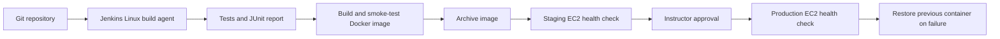

# Jenkins to EC2: a practical classroom project

Build a CI/CD pipeline from your first test run to an approved production deployment. This repository contains a working Node.js HTTP application, automated tests, a Docker image, three Jenkins lessons, and EC2 deployment scripts.

By the end, students should be able to explain CI versus continuous delivery, read a Declarative Pipeline, publish test results, build a traceable image, manage SSH credentials, deploy to EC2, diagnose failures, and restore a previous release.

## 1. Learning path

| Lesson | Pipeline script path | Outcome | Suggested time |
| --- | --- | --- | --- |
| Local foundations | No Jenkins yet | Run the app and tests | 30 minutes |
| Basic CI | `pipelines/Jenkinsfile.basic` | Checkout and publish test results | 45 minutes |
| Docker CI | `pipelines/Jenkinsfile.docker` | Build and health-check a container | 45 minutes |
| Advanced delivery | `Jenkinsfile` | Staging, approval, production, rollback | 90 minutes |

These are separate Pipeline jobs pointing at the same repository. Complete them in order. The advanced lesson uses two application EC2 instances, one per environment. Start with staging only to reduce lab cost.



The advanced job builds once and transfers that same image archive over SSH to each environment. No registry or AWS access key is needed by Jenkins. AWS resources are created manually for this lab; the pipeline deploys the application, not the infrastructure. Approval makes this **continuous delivery**. Each deployment briefly stops the old container, so it is not a zero-downtime design.

## 2. Prerequisites and lab layout

- Familiarity with Git, basic Linux commands, SSH, and AWS EC2.
- A Git hosting account and an AWS account permitted to create EC2 instances, security groups, and key pairs.
- Local Git and Node.js 22 or later. Docker is needed from lesson 3 onward.
- A Jenkins LTS controller and a trusted Linux x86_64 agent labeled `linux-docker`, with Node.js 22+, npm, Git, Bash, Docker CLI/daemon, and OpenSSH client (`ssh`, `scp`, `ssh-agent`).
- Amazon Linux 2023 **x86_64** application instances; keep the build agent and application CPU architecture the same.

For a small classroom, provision a Jenkins host with about 4 GB RAM and 30–50 GB storage, plus application hosts with about 1 GB RAM and 10 GB storage each. These are lab starting points, not capacity guarantees. Check costs in your region, set an AWS Budget, and do not assume any resource is free. Public IPv4 addresses and storage can incur charges.

Prefer a separate build agent and zero executors on the controller. A disposable, single-user lab can run builds on the controller: give its built-in node the `linux-docker` label and one executor. Docker access is effectively root access; never run untrusted pull requests on this node or give them deployment credentials.

## 3. Run locally

From the project directory:

```bash
node --version
npm test
npm start
```

No `npm install` is required: the app and tests use only Node.js built-in modules. In another terminal:

```bash
curl http://localhost:3000/
curl http://localhost:3000/health
```

On Windows PowerShell use `curl.exe` if `curl` is an alias. The health response is `{"status":"ok"}`. The root endpoint includes a message and the release version. Stop with Ctrl+C.

Try Docker with a running Linux container engine:

```bash
docker build -t classroom-app:local .
docker run --rm --name classroom-local -p 3000:3000 classroom-app:local
```

The container runs as a non-root user. Jenkins later runs it with a read-only filesystem and dropped Linux capabilities. The service intentionally has no database or persistent state.

Push the project to a repository you own:

```bash
git init
git add .
git commit -m "Add Jenkins EC2 classroom project"
git branch -M main
git remote add origin https://github.com/YOUR_ACCOUNT/jenkins-ec2-classroom.git
git push -u origin main
```

Replace the URL with an existing empty repository. Do not commit SSH keys. `.gitattributes` keeps shell scripts compatible with Linux when edited on Windows.

## 4. Set up Jenkins

Install Jenkins LTS using the current [official Linux installation guide](https://www.jenkins.io/doc/book/installing/linux/), including its Java prerequisite and repository signing key. Avoid copying older installation commands with expired signing keys. On an Ubuntu package-based controller, obtain the first-run password with:

```bash
sudo cat /var/lib/jenkins/secrets/initialAdminPassword
```

Open the Jenkins setup wizard, install suggested plugins, and create an administrator account. Confirm these plugins are installed under **Manage Jenkins → Plugins**: Pipeline (including Declarative), Git, Credentials Binding, SSH Agent, JUnit, and Timestamper. Docker Pipeline is not required: these lessons call the Docker CLI directly.

Create a separate Jenkins user named `instructor`, or replace `submitter: 'instructor'` in the root Jenkinsfile with your approver's user ID. Jenkins administrators can also approve input steps. Do not share an administrator account among students.

Prepare the Linux agent with the prerequisites above using your OS package instructions. If the agent account is `jenkins`, Docker group access typically requires:

```bash
sudo usermod -aG docker jenkins
```

Restart the agent process/session after changing group membership. For a lab using the packaged Jenkins controller as its executor, restart `jenkins` with `sudo systemctl restart jenkins`. Verify **as the account running builds** that `node --version`, `npm --version`, `git --version`, `docker info`, and `ssh -V` work. An interactive user's tools or PATH may differ from Jenkins'. See [Jenkins agent setup](https://www.jenkins.io/doc/book/using/using-agents/) for connecting a dedicated agent.

Restrict Jenkins port 8080 and SSH to the instructor's address or trusted lab network. Use an SSH tunnel or a properly configured HTTPS reverse proxy for remote access; do not expose an unsecured classroom Jenkins server to the internet.

## 5. Lesson 1: basic CI

1. Select **New Item → Pipeline**, name it `classroom-basic`.
2. Under **Pipeline**, choose **Pipeline script from SCM → Git**.
3. Enter your repository URL; add a separate Git read credential if the repo is private.
4. Set branch specifier to `*/main` and script path to `pipelines/Jenkinsfile.basic`.
5. Save and click **Build Now**.

Declarative Pipeline checks out the selected repository automatically. The job prints tool versions, runs tests, and publishes `reports/tests.xml` through JUnit. Expect four passing tests and a green build. View the console and Test Result page.

**Exercise:** change the expected health status in `test/server.test.js` to `broken`, commit and push, then rebuild. Observe the failed test and failed build. Revert the change and verify green again. Explain why a failing test must prevent deployment.

For repeat runs you can enable **Poll SCM** with `H/5 * * * *`. This checks for changes without requiring an inbound webhook. Webhook setup is an optional later exercise.

## 6. Lesson 2: Docker CI

Create `classroom-docker` the same way, using `pipelines/Jenkinsfile.docker`. It tests the code, builds an image tagged with the Jenkins build number and Git commit, and launches an isolated container for its Docker health check. The temporary test container is removed afterward.

**Checkpoint:** find the image tag in the console and run `docker image ls classroom-app` on the agent. Explain why a commit-based tag is more traceable than `latest`. Tags are still mutable; the advanced job preserves the exact built archive for promotion.

**Exercise:** break the health-check URL in the Dockerfile. Unit tests should pass but the container smoke test should fail. Fix it before continuing.

## 7. Prepare EC2 staging and production

In the AWS console choose one region and launch an Amazon Linux 2023 x86_64 staging instance. Use a key pair whose private key you control. Repeat for production when ready. Tag each instance with your name, course, and environment. For a simple lab use a public subnet with an internet gateway route and public IP; private subnets require appropriate routing and outbound access instead.

Use these inbound security group rules:

| Destination | Port | Allowed source |
| --- | --- | --- |
| Application instances | TCP 22 | Jenkins agent security group in the same VPC, or agent's fixed outbound IP `/32`; instructor IP `/32` for setup |
| Application instances | TCP 80 | Student/instructor public IPs or trusted classroom CIDR |
| Jenkins controller | TCP 8080 | Instructor/trusted network only, if directly used |
| Jenkins/agent SSH | TCP 22 | Instructor IP `/32` |

Do not open SSH to `0.0.0.0/0`. No inbound port 3000 is necessary: Docker publishes host port 80 to container port 3000. Allow the outbound connectivity needed for OS packages and the agent's Git and image downloads. EC2 hostnames used by the pipeline must be reachable from the agent. See [AWS security groups](https://docs.aws.amazon.com/AWSEC2/latest/UserGuide/creating-security-group.html).

From a Bash terminal in this repository, replace the sample hostname and key path:

```bash
ssh -i /path/to/lab.pem ec2-user@STAGING_HOST
# Verify the server fingerprint through a trusted AWS console connection before accepting it.
exit
scp -i /path/to/lab.pem scripts/bootstrap-ec2.sh ec2-user@STAGING_HOST:/tmp/bootstrap-ec2.sh
ssh -i /path/to/lab.pem ec2-user@STAGING_HOST 'sudo bash /tmp/bootstrap-ec2.sh'
ssh -i /path/to/lab.pem ec2-user@STAGING_HOST 'docker info'
```

Repeat for production. Bootstrap installs Docker, starts it on boot, and gives `ec2-user` Docker access. The final SSH command starts a new session so new group membership applies. These hosts must be dedicated to the lab, with port 80 available. AWS documents [Docker setup on Amazon Linux 2023](https://docs.aws.amazon.com/AmazonECS/latest/developerguide/create-container-image.html).

## 8. Configure deployment credentials

In **Manage Jenkins → Credentials**, use a folder credential store restricted to these trusted jobs where possible. Add:

| ID | Kind | Content |
| --- | --- | --- |
| `ec2-deploy-key` | SSH Username with private key | Username `ec2-user`; the key authorized on both lab hosts |
| `ec2-known-hosts` | Secret file | Verified OpenSSH host-key entries for both hosts |

The scripts use `ec2-user` explicitly, so a different credential username alone will not change the remote user. For real environments use separate environment credentials and permissions; the shared key simplifies this lab.

Create the known-hosts file on a trusted machine. Substitute actual hostnames in these Bash commands:

```bash
ssh-keyscan -t ed25519 STAGING_HOST PRODUCTION_HOST > ec2-known-hosts
ssh-keygen -lf ec2-known-hosts
```

`ssh-keyscan` only collects keys; it does not authenticate them. Independently connect through a trusted AWS console method, such as EC2 Instance Connect, and run this on **each** host:

```bash
sudo ssh-keygen -lf /etc/ssh/ssh_host_ed25519_key.pub
```

Match each SHA256 fingerprint before uploading the file to Jenkins. Use exactly the same hostnames/IPs in the file and job parameters. For staging-only setup, collect just the staging entry and add production later. Never solve host-key errors by disabling strict checking. See [Jenkins credentials](https://www.jenkins.io/doc/book/using/using-credentials/) and [SSH Agent](https://www.jenkins.io/doc/pipeline/steps/ssh-agent/).

## 9. Lesson 3: advanced EC2 delivery

Create `classroom-deploy` from SCM on `*/main` with script path `Jenkinsfile`. Limit this job to trusted code and users: repository code can access credentials available to the job. Use one deployment job per environment pair; do not let the lesson jobs deploy to these hosts.

The first run may fail validation because Jenkins has only just created the parameters. Choose **Build with Parameters**, set `STAGING_HOST`, and leave `DEPLOY_PRODUCTION` false. No production host is required for this first deployment.

Stages perform these actions:

1. Validate host parameters and generate the build/commit image tag.
2. Run tests and build the image once.
3. Smoke-test the image, then archive `dist/image.tar` and `dist/image.txt` with Jenkins fingerprints.
4. Transfer the archive over verified SSH, load it on staging, and wait for Docker health status.
5. If requested, wait up to ten minutes for `instructor` approval.
6. Send the same archive to production and wait for health status there.

Browse `http://STAGING_HOST/` from an allowed network. The JSON version must match `dist/image.txt` without the `classroom-app:` prefix. Also check `/health`. Internal Docker health checks cannot prove that external routing or security groups work, so perform this browser check before approving production.

Now run with `DEPLOY_PRODUCTION` true and a separate `PRODUCTION_HOST`. Inspect staging, approve the waiting stage, and verify the production endpoint. Rejecting or timing out leaves production unchanged while staging stays at its new version. A production deployment failure rolls back production; staging stays at its new version.

The job prevents overlapping runs, limits duration, retains recent build artifacts, and locks remote deployments with `flock`. The lock is held per EC2 user and serializes cooperating scripts. It does not coordinate arbitrary manual Docker changes. A stopped previous container is retained for recovery. Old image cleanup is intentionally manual; monitor disk usage.

## 10. Rollback and failure lab

On the deployment host, the active container is `classroom-app`; the retained stopped container is `classroom-app-previous`. A failed startup or health check removes the attempted release and restarts the previous container. The Jenkins build still fails so operators see the incident. A failed first deployment has no prior version to restore.

To demonstrate rollback **on staging only**:

1. Complete a healthy staging deployment and record its version.
2. SSH into staging and run `docker image ls classroom-app`; copy that known-good image tag.
3. Create a deliberately unhealthy image and feed it to the real remote deployment script:

```bash
# Run in Bash on staging. Replace the FROM tag with the recorded image tag.
mkdir -p /tmp/classroom-bad-image
printf 'FROM classroom-app:REPLACE_WITH_GOOD_TAG\nHEALTHCHECK --interval=1s --retries=1 CMD exit 1\n' > /tmp/classroom-bad-image/Dockerfile
docker build -t classroom-app:rollback-demo /tmp/classroom-bad-image
```

From your workstation, copy `scripts/deploy-remote.sh` to staging with SCP. Then on staging:

```bash
set -o pipefail
docker save classroom-app:rollback-demo | bash /tmp/deploy-remote.sh classroom-app:rollback-demo
# Expected nonzero exit and 'Previous version restored'.
docker ps
curl http://localhost/
```

The returned version should be the original healthy version. This direct staging exercise deliberately bypasses the CI smoke-test gate so the remote failure path can be observed. Explain why the pipeline normally catches this bad image earlier.

For a deliberate redeploy of an older release, download `image.tar` and `image.txt` from the **same successful Jenkins build**. From a trusted Bash environment with SSH credentials loaded, place them under `dist/`, export `KNOWN_HOSTS` to your verified host-key file, and run:

```bash
bash scripts/deploy.sh STAGING_HOST "$(cat dist/image.txt)"
```

This redeploy uses the same health/rollback logic. Validate staging before repeating on production under your normal approval process. Keep old archives long enough for your rollback policy: the example only retains artifacts for three builds.

Signals trigger best-effort rollback. A machine crash or forced process kill can interrupt it; the next deployment attempts to recover a retained backup. If rollback fails, inspect the host directly. This teaching implementation does not provide high availability or transactional deployment guarantees.

## 11. Troubleshooting

| Symptom | Check / action |
| --- | --- |
| Waiting for an executor | Agent online, correct `linux-docker` label, available executor |
| `node` or `npm` not found | Install Node 22+ on the actual agent and check its service PATH |
| Docker permission denied | Agent/EC2 account group membership; restart session after bootstrap |
| Docker daemon unavailable | `sudo systemctl status docker`; local Docker Desktop must use Linux containers |
| SSH timeout | Agent routing, correct IP/DNS, port 22 source rule, instance status |
| Host key verification failed | Independently verify current fingerprint, update secret file for exact hostname |
| Permission denied (publickey) | Correct private key, `ec2-user`, matching instance key/authorized_keys |
| `sshagent` missing | Install SSH Agent plugin and OpenSSH client on agent |
| Port 80 already allocated | `docker ps` and `sudo ss -ltnp`; use a dedicated deployment host |
| Health check fails | `docker logs classroom-app`; `docker inspect classroom-app`; review failing Jenkins console |
| Browser cannot reach healthy app | Port 80 security group source, subnet routing, public address |
| `exec format error` | Agent and EC2 architectures differ; use x86_64 for both |
| Production approval unavailable | Create `instructor` user or adjust submitter ID and Jenkins authorization |
| Disk full | `docker system df`; review old images/artifacts before removing anything |
| Old server after stop/start | Public address may have changed; update job parameters and verified host entries |

## 12. Student submission and extension work

Submit your repository URL, a screenshot of each successful pipeline, a failed test report, the deployed version from staging and production, rollback evidence, and a short explanation of credential handling. Remove secrets and sensitive console output from submissions.

Suggested assessment: basic CI and test evidence (20%), Docker and smoke testing (20%), EC2 delivery (25%), approval and rollback demonstration (25%), documentation and cleanup (10%).

Advanced extensions, **not implemented in this starter**:

- Replace archive transfers with ECR and deployment by image digest; grant instance roles narrowly scoped permissions.
- Provision hosts and security groups with Terraform, then add policy checks.
- Separate CI from a restricted deployment job and isolate production credentials.
- Add an ALB, HTTPS, private subnets, and blue/green target groups for reduced downtime.
- Add image vulnerability scanning, an SBOM, and base-image digest pinning.
- Add application metrics, CloudWatch logging, and external smoke checks.
- Test recovery after interrupted deployments and design database migration rollback separately.

## 13. Cleanup

After collecting evidence, disable scheduled Jenkins jobs and terminate the lab EC2 instances you created. Check for retained EBS volumes, snapshots, Elastic IP allocations, and other chargeable resources. Remove lab-only security groups when unused, delete lab credentials from Jenkins, and remove unneeded keys from your computer. Stopping an instance alone does not remove all related charges.

## Repository map

```text
src/server.js                  HTTP app: / and /health
test/server.test.js            Endpoint tests using node:test
Dockerfile                     Non-root image and Docker health check
pipelines/Jenkinsfile.basic    Lesson 1: CI
pipelines/Jenkinsfile.docker   Lesson 2: container CI
Jenkinsfile                    Lesson 3: staged EC2 delivery
scripts/bootstrap-ec2.sh       One-time Amazon Linux setup
scripts/smoke-test.sh          CI container health gate
scripts/deploy.sh              SSH transfer from agent
scripts/deploy-remote.sh       Remote deployment, locking, rollback
```

For syntax and further study, see the [Jenkins Declarative Pipeline reference](https://www.jenkins.io/doc/book/pipeline/syntax/). This project must be validated in your own Jenkins/AWS lab before classroom use; local tests alone do not validate cloud networking, plugins, or permissions.
